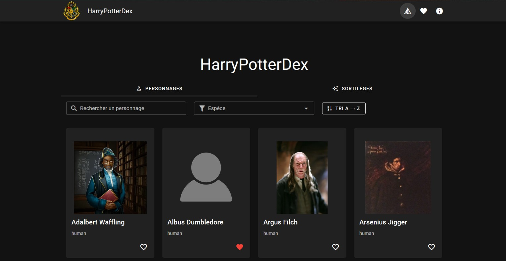
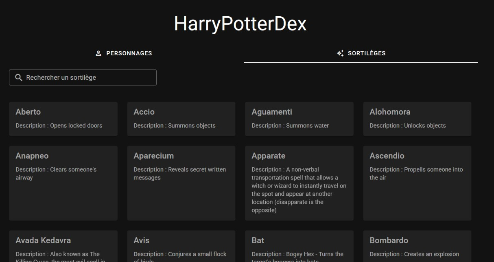
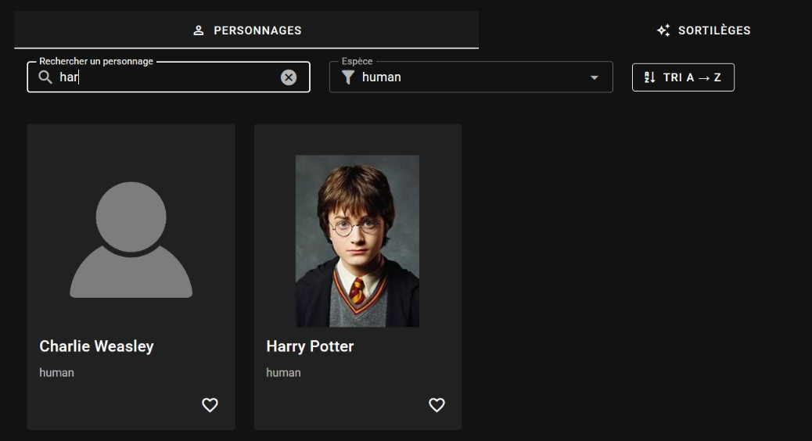
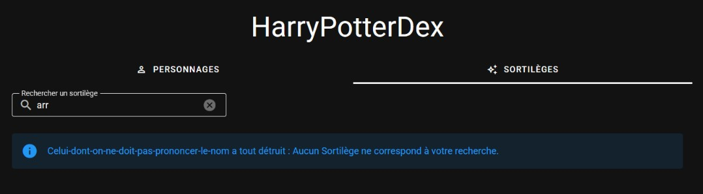
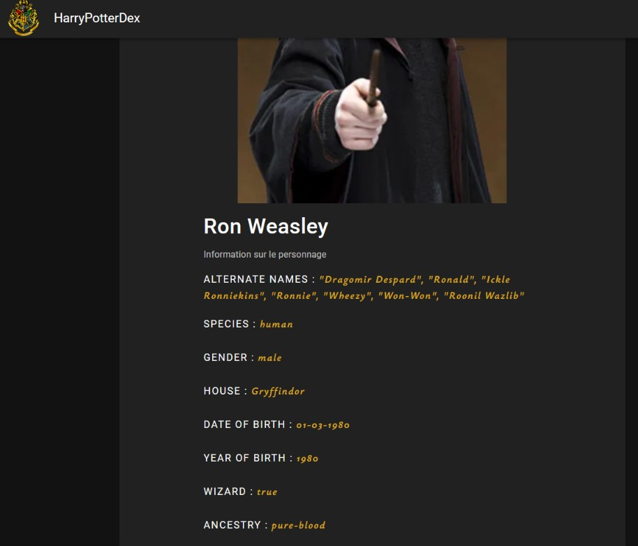
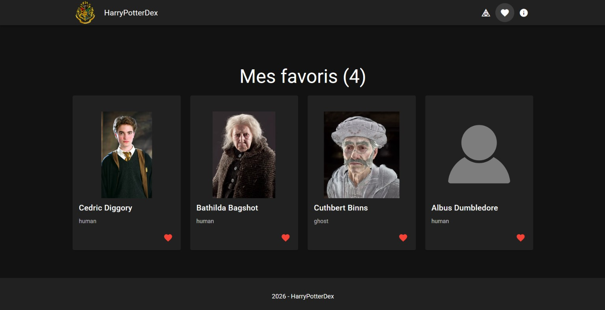
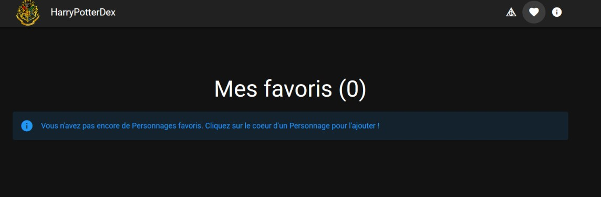
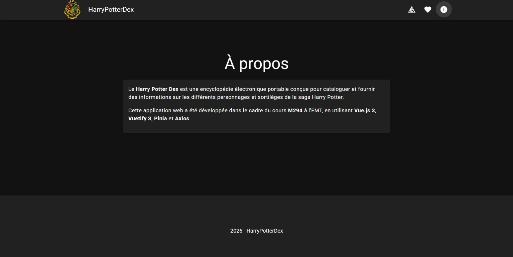
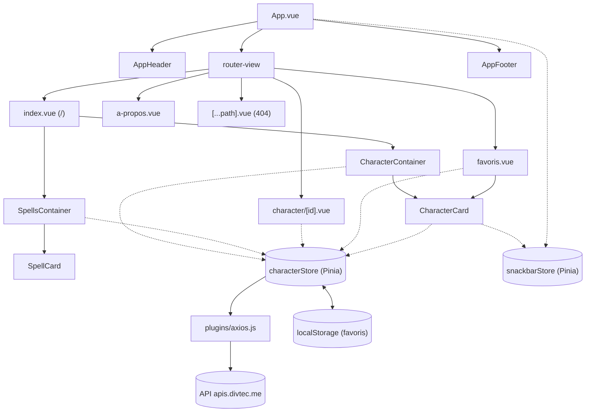
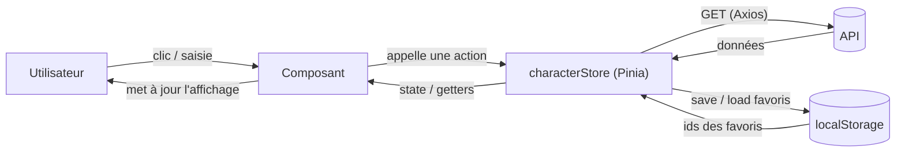

# Harry Potter Dex (Projet Vue.js & Vuetify)

## 1. Présentation du projet

### Concept
J'ai choisi une API Harry Potter car je suis un grand fan de cette saga. 
Le public cible peut être soit des développeurs juniors qui pourraient utiliser ce projet comme exemple, comme exercice 
ou comme template pour d'autres projets, soit des fans d'Harry Potter qui pourraient 
simplement l'utiliser pour se documenter sur les personnages et/ou les sortilèges de la saga. 
L'objectif technique de l'application est d'écrire du code propre afin que l'application puisse ensuite grandir et évoluer 
facilement, pour que des fonctionnalités puissent être rajoutées.
L'objectif fonctionnel est que l'application soit une mini-encyclopédie intuitive pour que n'importe qui puisse
trouver des informations très simplement. 

### Fonctionnalités principales
- Affichage d’une liste de nombreux personnages de la saga Harry Potter (via API)
- Affichage d'une liste de sortilèges de la saga (via API également)
- Recherche / Filtres : Des fonctions de recherche sur les personnages et les sortilèges sont disponibles 
pour filtrer les données de manière pertinente. 
- Pour les personnages, on peut rechercher via : 
  - Le nom/prénom
  - L'espèce 
- Pour les sortilèges, on peut uniquement rechercher par le nom.
- Tri : 
  - L'onglet Personnage possède un bouton pour alterner entre le tri par ordre alphabétique et l'ordre inverse.
  - Pour l'onglet des sortilèges, il n'y a pas cette option, les sorts sont déjà triés par ordre alphabétique.
- Vue détail : En cliquant sur un personnage cela ouvre une page de détail avec des informations détaillées sur le personnage. Elle comprend : 
  - Couleur des yeux 
  - Acteur 
  - Espèce 
  - Surnom 
  - Maison 
  - Année de naissance 
  - ...
> À noter que tous les personnages ne possèdent pas tous les mêmes informations

- Snackbar globale qui peut être appelée depuis n'importe où dans le code pour afficher un message
- Les sortilèges n'ont pas de vue détaillée, car il y a trop peu d'informations à présenter
- Fonctionnalité interactive des favoris : On peut ajouter des personnages à une liste de favoris pour les retrouver plus tard
- Persistance locale des favoris. Les favoris vont être stockés dans le localStorage du navigateur pour que la liste des
favoris soit directement initialisée à l'ouverture de la page dans le navigateur.

### Aperçu visuel

#### Page d'accueil : 


#### Onglet des sortilèges : 


#### Fonction de recherche et de tri : 


#### Aucun résultat : 


#### Vue en détail d'un personnage : 


#### Page des favoris :


#### Aucun favori :


#### Page d'information : 


---

## 2. Parcours d'apprentissage

### Ressources utilisées

#### Documentation & tutos

- [Police d'écriture](https://gwfh.mranftl.com/fonts)
- [Séparer des mots à chaque majuscule ([id].vue:cleTransforme)](https://stackoverflow.com/questions/7888238/javascript-split-string-on-uppercase-characters)
- [Tester si une valeur est un tableau ([id].vue:getValeurAafficher)](https://stackoverflow.com/questions/767486/how-do-i-check-if-a-variable-is-an-array-in-javascript)
- [Trouver des icônes mdi (notamment celui des reliques de la mort)](https://pictogrammers.com/library/mdi/)
- [Menu de navigation entre personnages et sortilèges](https://vuetifyjs.com/en/components/tabs/#usage)
- [Pour les composants Vuetify de manière générale](https://v2.vuetifyjs.com)
- [Pour les composants Vuetify de manière générale 2](https://vuetifyjs.com/en/components/all/)
- [Pinia Docs](https://pinia.vuejs.org/)
- [Vue 3 Docs](https://vuejs.org/guide/introduction.html)
- [Tuto Pokédex Vuetify](https://devjs.ch/exercices/pokedex-vuetify/)
- [Tuto et explication devjs.ch](https://devjs.ch)

**Autres ressources :**
- [Logo de Poudlard](https://fr.wikipedia.org/wiki/Fichier:Hogwarts-Crest.png) 
- Gimp : Pour la retouche de l'icône du menu principal (logo de Poudlard)
- [Générateur de favicon à partir d'une image](https://favicon.io/)
- [Ma version du Pokédex Vuetify](https://github.com/MatteoPiquerez/294-pokedex-piqumat)

#### Progression

##### 22 Septembre : 
- Création du projet, commit initial 

##### 5 Octobre : 
- Création des composants AppFooter et AppHeader
- Installation d'Axios et de Pinia dans le projet
- Création de .env et .env.example
- Création de CharacterCard qui affiche la carte des personnages 
- Création de \[id].vue pour la vue en détail des personnages
- Ajout de la page 404 par défaut 
- Ajout de la page "à propos"
- Ajout de l'initialisation automatique du store dans App.vue 
- Débogage : Je récupérais les personnages, mais je n'arrivais pas à y avoir accès. 

##### 6 Octobre : 
- Fix de toutes les recommandations du linter 
- Ajout de README_EXAMPLE.md dans lequel j'ai copié le README de base. 
Cela me permettra d'avoir toujours un exemple de la structure de base demandée pour la documentation.
- Intégration des VueDevTools au projet (je n'ai pas utilisé l'extension de navigateur)
- Résolution de l'erreur qui faisait que je ne pouvais pas obtenir les personnages du store. 
- Résolution de l'erreur qui faisait que je ne pouvais pas passer un personnage en props. 

##### 21 Octobre :
- Fix de l'erreur du getter du store qui doit retourner un personnage via son ID.
Il ne trouvait pas le personnage car il comparait une chaîne de caractères avec un nombre 

##### 22 Octobre : 
- Suppression de plusieurs fichiers inutilisés (HelloWorld par ex)
- Début de la rédaction de la documentation
- Correction de l'erreur qui faisait que les images ne s'affichaient pas : Il fallait changer l'URL de base qui était fausse.
- Intégration d'une fonction de recherche par nom ou par espèces. 
- Intégration d'une fonction de tri par ordre alphabétique ou l'inverse. 

##### 27 Octobre : 
- Implémentation de la gestion des favoris dans le store Pinia 
- Correction finale du getter du store qui faisait une comparaison de type invalide 
- Implémentation de l'affichage des favoris 

##### 28 Octobre : 
- Modification de la vue détaillée des personnages pour que chaque personnage affiche les propriétés qu'il possède.
- Ajout de style sur la carte des personnages.
- Ajout d'une image d'avatar par défaut pour les personnages qui ne possèdent pas d'image.
- Ajout de deux onglets de navigation un pour les personnages l'autre pour les sortilèges dans index.vue.

##### 29 Octobre : 
- Modification pour rendre les onglets mieux répartis et plus ergonomiques 
- Nettoyage du code
- Implémentation d'une fonction de recherche pour les sortilèges 
- Optimisation de la taille des images dans CharacterCard.vue et dans \[id].vue
- Review de tout le code, mise des commentaires, petites corrections et améliorations.
- Ajout des favicons pour le site.

##### 30 Octobre : 
- Implémentation de `toSorted()` au lieu de `sort()` sur une copie du tableau 
- Ajout d'une méthode initSpecies() qui va boucler sur chaque personnage et 
ajouter leurs espèces à la liste (si elle n'y est pas encore)

##### 2 Novembre : 
- Affichage d'un message d'erreur propre si aucun sortilège ou personnage n'est trouvé par la fonction de recherche.
- Suite de la rédaction de la documentation
- Amélioration de plusieurs fonctions grâce à Claude Code

##### 3 Novembre : 
- Ajout d’une règle de rewrite SPA pour Vercel
- Correction mineure et amélioration de plusieurs fonctions avec Claude
- Suite de la documentation

##### 4 Novembre : 
- Réalisation de captures d'écran de l'application pour le README
- Gros avancement dans la documentation

##### 5 Novembre : 
- Déplacement de l'image par défaut dans le dossier assets plutôt que de la laisser dans public 
- Ajout d'un état de chargement si on recharge la page sur une vue détaillée 
- Export de la constante API_BASE_URL et de sa valeur par défaut pour utiliser partout la même 
- Correction du chemin des icônes et du web manifest dans index.html 
- Ajout de texte alternatif pour les icônes 
- Grosse relecture du code et corrections mineures
- Ajout de la snackbar dans App.vue pour pouvoir l'utiliser partout dans l'application 
- Ajout du thème dark au lieu de système
- Ajout d'un aria-label sur le v-avatar
- Ajout des placeholders pour chaque champ de recherche.
- Finition de la documentation
- Finition de la V1 : Commit final

##### 7 Novembre : 
- Amélioration du responsive sur mobile avec Claude Code :
  - Taille des titres et des onglets adaptée aux petits écrans
  - Le nom des personnages passe à la ligne dans la vue détaillée au lieu de dépasser
  - Le titre de la barre de navigation devient « HPDex » sur mobile

---

## 3. Outils et méthodologie

### Environnement de développement
- **IDE** : WebStorm 
- **Versioning** : Git + GitHub
- **Dépendances principales** : Vue 3, Vuetify 3, Pinia, Axios
- **Gestion des variables d'environnement** : `.env` + `.env.example`

### Installation & Run
- Cloner le repo : `git clone https://github.com/MatteoPiquerez/294-projet-harry-potter-piqumat.git`
- Installer : `npm install` (installe toutes les dépendances)
- Variables d’environnement : Copier `.env.example` → `.env` 
- Lancer : `npm run dev` 

### Méthodologie
- Découpage de toute l'application en composants 
- Sortilèges et personnages passés en props 
- Store Pinia pour gérer l'état global de l'application et faire les appels API
- Beaucoup de commits pour détailler chaque étape de l'avancement.
- À chaque nouvelle fonctionnalité des tests sont effectués pour vérifier si elle fonctionne comme prévu
- Suivre chaque étape du Pokédex Vuetify, et à chaque étape intégrer les nouvelles notions à mon projet 
- M'assurer que je comprends toujours le code que j'ajoute à mon application 
- Privilégier la qualité à la quantité
- Avoir un README clair et structuré 
- Consulter des documentations plutôt que de demander à l'IA 
- Noter chaque source d'information ou de données
- Être transparent sur les logiciels utilisés
- Garder une arborescence de fichiers et de dossiers claire.
- Privilégier un rythme de travail régulier plutôt que de tout faire au dernier moment.

### Choix techniques
- API sélectionnée : https://apis.divtec.me
- Justification du choix : La Divtec a récupéré toutes les données d'une API Harry Potter connue pour 
ensuite les mettre à disposition.
Cela permet d'éviter certaines limitations (quotas, token)
- Endpoints utilisés :  
  - GET https://apis.divtec.me/api/harrypotter/characters pour les personnages 
  - GET https://apis.divtec.me/api/harrypotter/spells pour les sortilèges
- Limites/quotas connus : La limite d'objets retournés en une fois est de 20, 
on peut augmenter cette limite à 100 grâce à _?limit=100_ à la fin de l'URL
- Les endpoints contiennent plusieurs pages, 
on peut donc récupérer plusieurs fois 100 objets (autant de fois qu'il y a de pages).
- La pagination n'est pas utilisée dans mon application. 
J'estimais avoir assez de données avec cent objets pour chaque endpoint
- Il n'y a par contre pas de quota (par heure par ex).

### Déploiement 
L’application est déployée sur Vercel, ce qui rend le déploiement très simple.
Pour cela il suffisait de se connecter avec son compte GitHub et ensuite de sélectionner le repo
à publier. Pour finir Vercel nous demandait d'ajouter les variables d'environnement, et s'occupait 
automatiquement du build et du déploiement.
À chaque _push_ sur la branche _main_ Vercel redéploie automatiquement la nouvelle version.

**[Version déployée sur Vercel](https://294-projet-harry-potter-piqumat.vercel.app/)**

### Architecture (Descriptif + schéma simple + data-flow)

#### Descriptif
HarryPotterDex est une **SPA** (Single Page Application) développée avec **Vue 3** et **Vuetify 3**, et construite avec **Vite**. Le projet est organisé en 3 couches :

- **Les pages** (`src/pages/`) : Chaque fichier correspond à une route. Le routage est **généré automatiquement** à partir des noms de fichiers grâce à `unplugin-vue-router`. Par exemple, `favoris.vue` devient `/favoris` et `character/[id].vue` devient `/character/:id`.
- **Les composants** (`src/components/`) : Ils s'occupent de l'affichage. Les *Containers* gèrent la recherche, le filtre et le tri, les *Cards* affichent un seul élément.
- **Le store Pinia** (`src/stores/characterStore.js`) : Il centralise toutes les données (personnages, sortilèges, espèces, favoris, état de chargement). C'est le seul endroit qui communique avec l'API (via Axios) et avec le `localStorage`.

```
src/
├── App.vue                  → layout principal (header, router-view, footer, snackbar) + lance init() du store
├── main.js                  → crée l'application et enregistre les plugins
├── pages/                   → une page = une route
│   ├── index.vue            → /              : onglets Personnages / Sortilèges
│   ├── character/[id].vue   → /character/:id : détail d'un personnage
│   ├── favoris.vue          → /favoris       : personnages favoris
│   ├── a-propos.vue         → /a-propos      : informations sur le projet
│   └── [...path].vue        → toute autre URL : page 404
├── components/
│   ├── AppHeader.vue        → barre de navigation
│   ├── AppFooter.vue        → pied de page
│   ├── CharacterContainer.vue → recherche, filtre par espèce, tri + grille de personnages
│   ├── CharacterCard.vue    → carte d'un personnage + bouton favori
│   ├── SpellsContainer.vue  → recherche + grille de sortilèges
│   └── SpellCard.vue        → carte d'un sortilège
├── stores/
│   ├── characterStore.js    → state global, getters et appels API
│   └── snackbarStore.js     → gestion de l'affichage de la snackbar
├── plugins/
│   ├── axios.js             → instance Axios + API_BASE_URL
│   ├── vuetify.js           → configuration de Vuetify (thème)
│   └── index.js             → enregistre Vuetify, le router et Pinia
├── router/index.js          → création du router à partir des pages
├── layouts/default.vue      → layout appliqué automatiquement à chaque page
├── utils/imageUrl.js        → construit l'URL d'une image ou renvoie l'avatar par défaut
├── styles/settings.scss     → animation du cœur (heartbeat)
└── assets/                  → logo, image par défaut, police, favicons
public/                      → favicon.ico, site.webmanifest, icônes Android (copiés tels quels)
```

#### Schéma

> **Note :** Ce schéma est écrit en **Mermaid**, c'est-à-dire du texte transformé en diagramme. Il ne s'affiche pas forcément selon l'éditeur utilisé :
> - **Sur GitHub**, il faut cliquer sur l'icône de la double flèche **↔** du bloc pour afficher le diagramme.
> - **Dans WebStorm**, il faut installer le plugin **Mermaid** (Settings → Plugins → Marketplace).
> - **Sinon**, on peut copier le code du bloc dans [mermaid.live](https://mermaid.live) pour voir le diagramme.


*Les flèches pleines montrent quel composant contient quel autre. Les flèches en pointillés montrent quels composants lisent le store ou l'utilisent pour faire une action.*


#### Data-flow

**Data-flow résumé :**
- Un **événement** (démarrage de l'app, clic de l'utilisateur) → le composant appelle une **action du store** → le store modifie son **state** (et appelle l'API ou le `localStorage` si besoin) → les **getters** et les **computed** se recalculent → Vue **met à jour l'affichage** automatiquement.
- Les données descendent toujours **du store vers les composants** (lecture du state, des getters, et des props pour les *Cards*). Les composants ne modifient jamais le state directement, ils passent toujours par une **action**.

##### 1. Chargement des données (démarrage de l'application)
1. Au montage de `App.vue`, `onMounted` appelle l'action `characterStore.init()`.
2. `init()` passe `isLoading` à `true`. Les composants affichent alors des **skeleton-loaders**.
3. `fetchCharacters()` et `fetchSpells()` sont lancés **en parallèle** (`Promise.all`). Chacun fait une requête `GET` à l'API via l'instance Axios (`plugins/axios.js`).
4. Les réponses sont stockées dans le state (`characters` et `spells`). En cas d'erreur, la liste est vidée (`[]`).
5. `loadFavorites()` récupère les ids des favoris dans le `localStorage`, puis `initSpecies()` construit la liste des espèces (sans doublon) pour le filtre.
6. `isLoading` repasse à `false`. Les composants affichent les cartes, ou un message d'erreur si une liste est vide.

##### 2. Recherche, filtre et tri
1. L'utilisateur tape une recherche, choisit une espèce ou clique sur le bouton de tri. La valeur est stockée dans une `ref` **locale** au composant (`searchQuery`, `selectedSpecies`, `sortOrder`).
2. Les **computed chaînés** se recalculent automatiquement : `characters` (store) → `filteredBySpecies` → `filteredBySearch` → `sortedCharacters`.
3. Le `v-for` affiche une `CharacterCard` par personnage du résultat, en lui passant le personnage en **props**.

Le store n'est **jamais modifié** ici : On filtre et on trie une copie des données, et la liste d'origine reste intacte.

##### 3. Ajout / retrait d'un favori
1. L'utilisateur clique sur le cœur d'une `CharacterCard`. Cela appelle `handleToggleFavorite()`.
2. Le composant appelle l'action `toggleFavorite(character)`, qui ajoute ou retire l'id du personnage dans le state `favorites`.
3. `saveFavorites()` enregistre immédiatement la liste dans le `localStorage`, pour qu'elle survive à un rechargement de la page.
4. Les getters `isFavorite`, `getFavorites` et `totalFavorites` se recalculent. Le cœur change de couleur, la page Favoris et son compteur se mettent à jour.
5. Une **snackbar** confirme l'action à l'utilisateur.

##### 4. Affichage du détail d'un personnage
1. L'utilisateur clique sur une carte. Le router navigue vers `/character/:id`.
2. La page `character/[id].vue` lit l'id dans l'URL (`route.params.id`) et appelle le getter `getCharacterById(id)` dans un `computed`.
3. Les propriétés du personnage sont parcourues (`Object.keys`) pour afficher toutes ses informations.
4. Si la page est rechargée (F5), le store se recharge d'abord. Un skeleton s'affiche pendant `isLoading`, puis le personnage, ou un message « Personnage non trouvé » si l'id n'existe pas.

##### Schéma du data-flow
*(Même remarque que plus haut pour l'affichage du schéma Mermaid.)*



---

## 4. Tests et validation

### Tests techniques
- Le store fonctionne, les données sont récupérées correctement grâce à l'API 
- La mise en favoris fonctionne, le personnage est ajouté au localStorage et dans la liste des Favoris du store.
- On peut recharger une page lorsqu'on est sur une route Vue. Le chemin est directement recalculé.
- Lorsqu'un filtre est ajouté/retiré des recherches, les données sont directement recalculées grâce au Computed.
- L'affichage de la vue détaillée d'un personnage grâce à son ID fonctionne.
- Le routage entre chaque page fonctionne. 
- L'avatar par défaut s'affiche correctement si le personnage ne possède pas d'image
- La vue détaillée d'un personnage affiche tous les attributs que possède le personnage
- L'ajout et la suppression d'un favori affichent bien une snackbar avec un message.
- On traite les 3 états de l'appel API (chargement, erreur, données).
- On affiche un message clair si aucun résultat n'est trouvé suite à une recherche
- Chaque personnage et sortilège est correctement passé en props aux _Card_
- La page est bien déployée sur Vercel

### Tests d’UX
- Un skeleton-loader s'affiche pendant que le store récupère les données 
- Une snackbar s'affiche avec un message pour informer que le personnage a été ajouté ou supprimé des favoris.
- Il y a un feedback utilisateur en cas de liste vide ou en cas de problème de chargement des données.
- Le curseur se transforme en main sur tous les éléments cliquables.
- Chaque champ de recherche, de filtre ou de tri décrit bien ce qu'il fait et dans quel état il est.
- La page actuelle est clairement visible grâce au rond clair entourant l'icône de la page.
- Le logo du site est cliquable et ramène à la page d'accueil 
- Il y a une animation et un changement de couleur du coeur à l'ajout ou au retrait d'un favori.
- La navigation est intuitive et respecte les standards du web.

### Tests d’accessibilité
- Contraste de couleur : Tout est respecté, les couleurs majoritaires sont le noir et le blanc (très bon contraste)
Les composants Vuetify ont par défaut un très bon contraste.
- La navigation grâce à la tabulation fonctionne parfaitement, les focus se font sur chaque élément 
- Toutes les images ont des textes alternatifs décrivant l'image
- Tout est structuré dans des balises sémantiques pour faciliter la compréhension par les lecteurs d'écran.
- Chaque champ de recherche possède un placeholder et un label clair et explicite 
- Le site est responsive, rétrécissement des éléments pour une page plus petite, changement du nombre de colonnes
si la taille de l'écran change. Les titres, les onglets et le nom des personnages s'adaptent aussi aux petits écrans,
et le titre de la barre de navigation est raccourci en « HPDex » sur mobile.
- Toute la navigation au clavier est fonctionnelle.
- Chaque balise est choisie pour avoir la meilleure affordance possible.

### Tests d’erreurs & fallback
- API down : Affichage d'un message d'erreur demandant à l'utilisateur de vérifier que l'URL de l'API est bien joignable.
- Liste vide : S'il n'y a aucun favori par exemple, un message va le signaler à l'utilisateur
et l'inviter à ajouter un personnage en favori  
- Recherche sans résultat : Un message informe qu'aucun résultat ne correspond à la recherche (avec un clin d'oeil à la saga)
- Si un personnage ne possède pas d'image : Grâce à la fonction `getImageUrl()` 
on va lui assigner une image d'avatar par défaut

---

## 5. Usage d’intelligence artificielle

### IA utilisée

#### Copilot
- **Nom** : Microsoft Copilot
- **Version** : 2.20261020.70.0
- **Contexte** : Aide ponctuelle pour intégrer les outils de debugging Vue JS 

`package.json` : Ajout de VueDevTools
```js
    "vite-plugin-vue-devtools": "^8.2.1",
```

`vite.config.mjs` : Ajout du plugin VueDevTools
```js
// Utilities
import { defineConfig } from 'vite'
import { fileURLToPath, URL } from 'node:url'
import VueDevTools from 'vite-plugin-vue-devtools'

// https://vitejs.dev/config/
export default defineConfig({
  plugins: [
    VueRouter(),
    VueDevTools(),
    Layouts(),
    Vue({
      template: { transformAssetUrls },
```

#### Claude Code (Opus 5)
- **Nom** : Claude Code v2.1.246
- **Version** : Opus 5
- **Contexte** : Correction de fonction et améliorations mineures.

##### getImageUrl()

**Fonction corrigée :** `getImageUrl()`
La fonction qui était censée retourner la bonne image pour chaque personnage, ou alors l'image par défaut
si le personnage n'en possédait pas, ne fonctionnait pas. 

**Version de Claude :**
```js
import defaultUserImage from '@/assets/default_user_image.png'

export function getImageUrl (filename, fallback = defaultUserImage) {
    if (!filename) {
        return fallback
    }
    return `${import.meta.env.VITE_API_URL}/${filename}`
}
```

##### v-card 

**Correction :** Claude a ajouté des classes à la v-card pour lui donner le bon style. 
Avant cela, il y avait des textes qui débordaient et les cartes sortaient du cadre.

**Code généré :**
```vue
  <v-card class="h-100" hover>
    <v-card-title class="text-wrap">{{ spell.name }}</v-card-title>
    <v-card-text>Description : {{ spell.description }}</v-card-text>
  </v-card>
```

#### Claude free 
- **Nom** : Claude free
- **Version** : Sonnet 5.5
- **Contexte** : Amélioration de fonction.

##### getValeurAafficher()
La fonction que j'ai écrite :
```js
  function getValeurAafficher (valeur) {
    if (valeur === null || valeur === undefined) return ''
    if (Array.isArray(valeur)) {
        let list = ''
        for (let i = 0; i < valeur.length; i++) {
            if (i !== 0) {
                list += ', '
            }
            // chaque élément de la liste est entouré de guillemet (volontaire).
            list += `"${valeur[i]}"`
        }
        return list
    }
    return valeur
}
```

Version améliorée de Claude : 
```js
function getValeurAafficher(valeur) {
  if (valeur === null || valeur === undefined) return ''
  if (Array.isArray(valeur)) {
    // chaque élément de la liste est entouré de guillemets (volontaire).
    return valeur.map(v => `"${v}"`).join(', ')
  }
  return valeur
}
```

##### initSpecies()
La fonction que j'ai écrite : 
```js
initSpecies () {
    for (const character of this.characters) {
        const species = character.species
        if (!this.species.includes(species)) {
            this.species.push(species)
        }
    }
}
```

Version améliorée de Claude :
```js
initSpecies () {
    this.species = [...new Set(this.characters.map(c => c.species))]
}
```

##### Génération des clés des personnages 
La fonction que j'ai écrite : 
```js
const cles = []
for (const cle in character.value) {
    if (cle === 'id' || cle === 'image' || cle === 'name') {
        continue
    }
    cles.push(cle)
}
```

Version améliorée de Claude : 
```js
const CLES_EXCLUES = new Set(['id', 'image', 'name'])
const cles = computed(() =>
    Object.keys(character.value)
        .filter(cle => !CLES_EXCLUES.has(cle)),
)
```

#### Claude Code (Opus 5.5)
- **Nom** : Claude Code
- **Version** : Opus 5.5
- **Explication** : Il y a deux sections Claude Code, car j'ai utilisé deux modèles différents.
- **Contexte** : Correction de bouts de code, aide pour la documentation.

##### Modification pour les icônes dans index.html
Les icônes ne s'affichaient pas sur certains navigateurs, car le chemin dans index.html était faux.
L'IA m'a dit que site.webmanifest, favicon.ico et les deux images _android-chrome_ devaient se trouver dans _public_.

**Code généré :** 
```html 
<link rel="icon" href="/favicon.ico">
<link rel="apple-touch-icon" sizes="180x180" href="/src/assets/favicon/apple-touch-icon.png">
<link rel="icon" type="image/png" sizes="32x32" href="/src/assets/favicon/favicon-32x32.png">
<link rel="icon" type="image/png" sizes="16x16" href="/src/assets/favicon/favicon-16x16.png">
<link rel="manifest" href="/site.webmanifest">
```

L'IA m'a également ajouté ces 2 attributs dans le fichier _site.webmanifest_ : 
```json
"name": "HarryPotterDex",
"short_name": "HPDex",
```

##### Réalisation de la section : _Architecture (Descriptif + schéma simple + data-flow)_
Claude a entièrement réalisé cette section. Je lui ai demandé de le faire car les diagrammes de structure et de 
data-flow m'auraient pris beaucoup de temps à faire à la main. 
J'ai ensuite contrôlé ce qu'il avait fait pour vérifier que tout était juste et valide.

##### Responsive sur mobile
Certains éléments étaient trop grands sur mobile : les titres, les onglets, et le nom des personnages 
qui dépassait de la carte dans la vue détaillée. 
Claude m'a proposé d'utiliser les classes responsive de Vuetify plutôt que d'écrire du CSS. 
Une classe sans préfixe (ex. `text-h5`) s'applique sur tous les écrans, et une classe avec `sm` 
(ex. `text-sm-h3`) s'applique à partir de 600px de large.

**Code généré :**
```html
<!-- Titre de la page d'accueil -->
<h1 class="text-h5 text-sm-h3 text-center my-6">HarryPotterDex</h1>

<!-- Onglets -->
<v-tab class="text-caption text-sm-button" value="personnages">

<!-- Nom du personnage : text-wrap autorise le retour à la ligne -->
<v-card-title class="text-h5 text-sm-h4 text-wrap">

<!-- Titre de la barre de navigation : nom raccourci sur mobile -->
<v-toolbar-title>
  <span class="d-none d-sm-inline">HarryPotterDex</span>
  <span class="d-sm-none">HPDex</span>
</v-toolbar-title>
```

##### Review de Code générale 
Claude a relu tout le code pour suggérer des améliorations. 
Les améliorations majeures sont documentées dans ce chapitre. 
Il a également relevé des améliorations mineures : 
- Commentaire faisant encore référence au Pokémon 
- Texte alternatif manquant
- État de chargement manquant pour la page de détail des personnages
- Couleur du site _dark_ au lieu de _system_
- Aria-label sur le v-avatar
- Placeholder manquant pour les champs de recherche.

Les améliorations mineures ont été relevées par Claude, mais corrigées par moi.

##### Correction d'orthographe et cohérence de la documentation
Claude a relu toute la documentation et a corrigé toutes les fautes d'orthographe.
Il a corrigé les majuscules et certaines tournures, et m’a signalé les autres pour que je les corrige.
Il a aussi contrôlé la correspondance de ma documentation par rapport à mon projet.

### Utilisation détaillée
J'ai très peu utilisé l'IA. C'était un choix personnel, étant donné que le projet doit être présenté et connu en détail,
j'ai préféré privilégier une utilisation ponctuelle de l'IA et coder l'essentiel du projet moi-même. 
C'est la raison pour laquelle il y a assez peu de fonctionnalités très avancées.
Je l'ai utilisée principalement pour de l'amélioration de fonctions (détaillée ci-dessus).

**Domaines d'aide :**
- Aide au code général : 10%
- Génération de snippets Vue/Vuetify : 5%  
- Aide à la structuration du projet : 2%
- Debugging : 2% (VueDevTools)  
- Documentation : 15%
- Recherche d’idées : 0%  

**Compréhension et adaptation**
Le code généré pour des fonctions n'ajoute rien en termes de fonctionnalité. 
Les fonctions que j'avais codées moi-même étaient fonctionnelles, mais l'IA les a rendues plus propres et plus optimisées.

Les autres petits bouts de code générés par IA ont été compris et/ou documentés.

Le code d'IA n'a pas dû être adapté au projet, car je fournissais toujours la fonction que j'avais codée 
moi-même pour que l'IA l'améliore. Elle avait donc déjà les bons noms de fonctions, variables, etc.
Le code était donc déjà adapté

### Parties codées manuellement
- Composants principaux : 95% personnel  
- Store & persistance : 98% personnel  
- Routing & navigation : 100% personnel  
- Tests & validation : 100% personnel  

### Apprentissage personnel
J’ai peu appris de nouvelles notions grâce à l’IA sur ce projet. 
Dans ce projet, j'ai utilisé essentiellement les notions vues en cours et appliquées dans le Pokédex Vuetify. 
Grâce à ces deux sources, j'ai pu faire pratiquement tout le projet.

Mais l'IA m'a appris et fourni plusieurs méthodes pour améliorer mon projet. 
Je pourrai donc réutiliser ces méthodes prêtes et optimisées pour de futurs projets.

---

## 6. Bilan personnel

### Ce que j’ai appris
J'ai appris énormément sur le fonctionnement général d'un framework web : 
- Les applications SPA
- Les composants 
- Les liaisons simplifiées avec v-bind
- Le routage automatique pour les pages du dossier pages 
- Les données recalculées automatiquement grâce à computed. 
- Les composants déjà prêts de Vuetify 
- Les props/emits
- Les stores

J'ai découvert que l'on peut faire de grosses applications web de manière très simple sans se battre
avec plein de fichiers html. 
J'étais toujours très impressionné en voyant de très grosses applications web en imaginant le travail que ça avait dû 
demander. Mais je me rends compte qu'avec des frameworks, c'est beaucoup plus rapide. 

Au début, je trouvais que ce qui était compliqué, c'était le nombre de fichiers comparé à un projet html tout simple.
Il y avait énormément de fichiers et de dossiers dont je ne savais pas l'utilité.
Et après plusieurs cours et quelques tutos, j'ai commencé à comprendre l'utilité de chaque chose.

### Difficultés rencontrées
**Je n'arrivais pas à récupérer la liste des personnages**
Le store ne m'affichait pourtant pas d'erreur. 
Le problème venait du fait que les réponses se trouvaient dans un tableau _data_.
Il fallait donc faire `response.data.data` pour récupérer les personnages. 

**Je n'arrivais pas à récupérer un personnage grâce à son ID avec le getter du store**
Le getter retournait toujours _undefined_ même quand on passait un ID valide.
Le problème venait du fait que le getter comparait l'id de la route (une String) 
avec l'ID du personnage (un nombre) et donc les types ne correspondaient pas -> comparaison invalide.
Pour résoudre le problème, le store convertit l'id de la route en nombre.

**Les images des personnages ne s'affichaient pas et je ne savais pas pourquoi**
L'URL de base pour les endpoints de l'application était : https://apis.divtec.me/api/harrypotter
Mais l'URL de base pour les images était : https://apis.divtec.me/images/harrypotter
Comme les deux URL ont une base différente, la fonction `getImageUrl()` tentait d'aller chercher les images 
à cette adresse : https://apis.divtec.me/api/harrypotter/images/harrypotter (URL invalide)
Pour résoudre ce problème, il a fallu changer l'URL de base et mettre : https://apis.divtec.me
Ensuite, il a également fallu changer les appels Axios du store.

**Je n'avais pas accès à ma constante Character qui était passée en props dans CharacterCard**
Quand je faisais `character.image` dans mon composant, l'image n'était pas trouvée. 
J'ai trouvé la solution dans l'exemple du Pokédex Vuetify

Code de base : 
```js
defineProps({
    character: {
        type: Object,
        required: true,
    },
})
```
Correction : 
```js
const { character } = defineProps({
    character: {
        type: Object,
        required: true,
    },
})
```

#### Aide reçue et source 
- Je me suis beaucoup appuyé sur le Pokédex Vuetify pour les corrections.
- Les explications en cours m'ont permis de résoudre le problème de `response.data.data`
- M. Tirole m'a aidé à résoudre le problème du getter du store, et le problème de l'URL de base invalide
- Je me suis aidé du Pokédex pour résoudre le problème de la constante _Character_ passée en props
- M. Tirole m'a également fournit le code et les explications pour l'implémentation de la snackbar globale

### Réussites et fiertés
L'aspect du projet dont je suis assez fier, c'est la propreté. 
Il y a relativement peu de code, mais il est structuré, documenté et il me semble assez propre. 
Je pense que c'est important pour que le projet puisse grandir proprement et de manière structurée. 
Je suis également assez fier de l'avoir fait majoritairement sans IA, cela m'a pris beaucoup plus de temps, 
mais cela m'a permis de beaucoup mieux comprendre mon code, de mieux assimiler les notions techniques, de déjà prendre 
de l'avance sur ma défense en oral (car je connais déjà bien mon code) et également de me forcer à chercher soit par 
moi-même soit sur internet avant de demander bêtement à une IA.

Je constate également que j'ai intégré énormément de notions de Vue.js et du web de manière plus générale.
J'avais déjà fait un projet avec Vue.js au travail, mais je n'avais pas reçu de formation sur le framework. 
J'ai donc appris sur le tas et je me suis rendu compte grâce à ce cours qu'il me manquait un gros bagage technique et 
théorique sur ce framework.

Pour mes envies de développement futur, maintenant que je maitrise beaucoup mieux Vue, j'ai envie de reprendre 
mon projet Vue.js au travail pour pouvoir intégrer toutes les bonnes pratiques et les concepts appris durant ce module.

### Améliorations possibles
**Fonctionnalités que j'ajouterais avec plus de temps :** 
- Une fonction qui boucle sur les pages de l'API pour récupérer encore plus de données. 
- Une fonction pour pouvoir ajouter des sorts en favoris. 
- Une fonction de battle : On choisit un personnage, on reçoit une liste de sortilèges et on doit ensuite les 
utiliser à bon escient pour attaquer l'ennemi ou parer ses sortilèges. 
- Battle des maisons : On choisit un personnage d'une maison et ensuite, il y a des questions et si on répond juste cela 
nous permet de gagner des points. 

**Compétences que j'aimerais approfondir :** 
- En apprendre plus sur les composants Vuetify : La library est gigantesque et j'ai le sentiment de ne pas toujours 
avoir utilisé le composant le mieux adapté à ce que je voulais faire. Étant donné que les composants sont déjà stylisés, 
cela permet de gagner un temps immense. Donc une bonne connaissance des composants est un vrai plus, je pense.
- Apprendre comment marchent les classes des composants Vuetify, j'ai vu que sur plein de composants il y a des classes
qui sont ajoutées et je ne sais pas toujours comment elles marchent et les styles qu'elles modifient. Pour ce point-là aussi,
je pense que c'est un plus de maitriser cette notion. 

---

## 7. Références & Sources
- Documentation de l’API : [API Harry Potter](https://apis.divtec.me/api/harrypotter/docs)  
- Tutos clés utilisés : Voir les ressources de documentation (section _Documentation & tutos_) 
- Usage de l’IA : Voir section ci-dessus
- Autres ressources utiles : _Documentation & tutos > Autres ressources_
